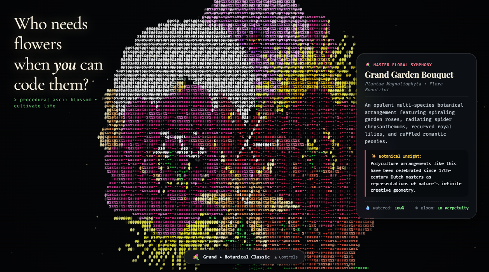

# ASCII Botanical Garden & Time-Lapse Floral Simulation 🌸

An interactive procedural ASCII botanical engine, organic seedling time-lapse, and real-time ASCII rasterizer. Inspired by National Geographic botanical cinema and viral creative code experiments:
- **["Who needs flowers when you can code them?" — ASCII Lily Bouquet by @arimecoa](https://www.instagram.com/reel/De1IvFqSihx/)**
- **[Procedural seedling sprout & bloom dynamics](https://www.instagram.com/reel/DefhSsAoMJd/)**
- Reference: **[National Geographic Time-Lapse: Watch Flowers Bloom Before Your Eyes](https://www.youtube.com/watch?v=LjCzPp-MK48)**



---

## 🌺 Key Features

1. **🌱 Seedling on Organic Soil**:
   - Begins at the dark soil layer with a curved seedling sprout, dual pairs of cotyledon leaves, mineral pebbles, and orbiting sacred-geometry ASCII particle rings.
2. **🧑‍🌾 Vintage Farmer & Procedural Web Audio**:
   - Clicking **"Add Water & Cultivate"** prompts a vintage farmer character (straw hat, denim overalls, galvanized watering can) to walk to the seedling with footstep audio, tilt the can, and sprinkle water with splashing sound effects.
   - All sounds (footsteps, water pouring stream, bloom whoosh, resonant sine chimes) are generated procedurally with the Web Audio API without external audio assets.
3. **💐 Upward Stem Bouquet Morph**:
   - The seedling lifts against gravity, straightens its stem, and branches into a bountiful 13-bloom bouquet arrangement with stems rooted in the soil bed.
4. **✨ Split Typography Glide**:
   - The headline *"Who needs flowers when you can code them?"* starts clustered above the landing sprout.
   - Upon blooming, it glides smoothly to the lateral margin (`#title-left`), remaining readable against the negative space.
   - Headline typography colors react to the active theme/design system.
5. **📜 Botanical Species Dossiers**:
   - Live information dossiers on the right margin highlighting botanical history and insights for each flower species.
   - Unique typography per flower (Playfair Display, Cormorant Garamond, Cinzel).
   - Includes the playful Easter egg for Spider Chrysanthemums:
     > *"Under chrysanthemums...\n(Ensure you check the spelling — this is the actual spelling 😂! C-h-r-y-s-a-n-t-h-e-m-u-m-s!)"*
6. **🎛️ Minimal Spring Collapsible Dock**:
   - Clean collapsed pill at the bottom center (`#dock-collapsed-pill`).
   - Expands on hover with spring physics (`cubic-bezier(0.34, 1.56, 0.64, 1)`).
   - Houses controls for **Flower Species**, **Design System / Theme**, **Audio toggle**, and **Re-water**.
7. **🎨 5 Design Systems / Themes**:
   - **Botanical Classic**: Lush crimson, gold, and verdant greens.
   - **Midnight Gold**: Opulent golden yellows, amber, and honey radiance.
   - **Sakura Dream**: Pastel blush pinks, cherry blossom rose, and soft emeralds.
   - **Cyberpunk Neon**: High-contrast electric magenta, cyan, and laser yellow.
   - **Phosphor Matrix**: Retro green monochrome CRT terminal phosphor.

---

## 🌼 Flower Species

| Species | Morphology | Bloom Dynamics |
|---|---|---|
| **💐 Grand Garden Bouquet** | 13-bloom arrangement combining Lilies, Roses, Chrysanthemums, and Peonies | Multi-tiered bouquet growth with cascading lateral flowers |
| **🌹 English Garden Roses** | 32-petal Fibonacci spiral whorls ($137.5^\circ$), ruffled scalloped margins, velvety core | Sepals peel back, outer petals unroll, spiraled cabbage center opens |
| **🌼 Spider Chrysanthemums** | 80+ radiating curved quill/spoon florets across 6 concentric rings | Floral fireworks explosion; tubular florets arch and uncurl outward |
| **🌺 Royal Asiatic Lilies** | 6 massive recurved star tepals, throat papillae, 6 pollen stamens | Buds swell, split, tepals roll back in 3D, filaments spring forward |
| **🌸 Romantic Peonies** | 50+ layered, voluminous, crinkled ruffled petals | Round bud bursts open in pillowy, voluminous waves |

---

## 🔬 Dual-Canvas ASCII Rasterizer Engine

Directly rendering tens of thousands of colored DOM glyphs causes severe frame drops. This simulation runs on a high-speed **dual-canvas graphics pipeline**:

1. **Vector Geometry Canvas**: Renders high-precision Bezier petals, linear gradients, dynamic shadows, and leaf veins.
2. **Dual-Channel Intensity Mapping**:
   $$\text{Intensity} = 0.42 \times \text{Luminance} + 0.58 \times \max(R, G, B)$$
   Standard perceived luminance ($0.299R + 0.587G + 0.114B$) penalizes deep reds and rich greens. By blending luminance with maximum channel intensity, petals maintain vibrant character density across all glyph ramps.
3. **CRT Shimmer & Ambient Wind**: Micro-temporal glyph jitter and spring-damped cursor breeze physics create organic motion.

---

## 🚀 Getting Started

No build step or dependencies required. Open [`index.html`](index.html) in any modern browser:

```bash
# Serve locally
python -m http.server 5500
```
Visit `http://localhost:5500`.

### Keyboard Shortcuts
- `Space` or `W`: Add Water / Re-water
- `S`: Toggle Audio
- `H`: Toggle UI dock and dossier cards for clean cinematic viewing
